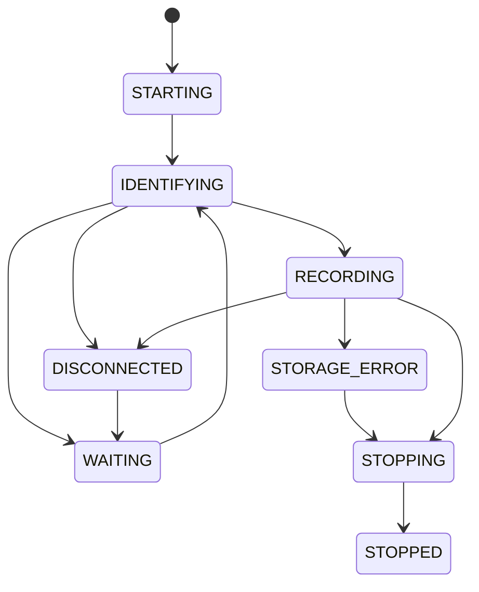

# Stage 2.1 — контракты длительной регистрации

Актуализация 2026-10-27: `record` реализован в Stage 2.2 (0.4.0.dev2), см.
[stage2_2_report.md](stage2_2_report.md). Схемы v1 и интерфейсы ниже сохранены.
Формулировки «исполнители отсутствуют»/«record NOT_IMPLEMENTED» описывают состояние 2.1.

Дата: 2026-10-23. Основа: принятый пользователем Stage 1 0.3.0, hardware retest
PASS WITH LIMITATIONS. Разработка: **0.4.0.dev1**, контракт **stage2.1/v1**.
Это архитектурная основа. Исполнители длительной записи, reconnect и recovery отсутствуют.

## 1. Границы и совместимость

Существующие serial/diagnose/replay/mock/ports, engine, Sources, UTCWriter, Diagnostics,
PhaseTracker и адаптеры F9P/X20P сохраняются. Новый recording/ отделяет будущий runtime
от короткого диагностического цикла Stage 1. Рефакторинг единственного читателя и storage
будет выполнен в 2.2; второй параллельный читатель COM не допускается.

Никаких изменений конфигурации: текущий allowlist MON-VER и ограниченного RAM VALGET
остаётся единственным физическим send-путём. VALSET/VALDEL/RESET, изменение измерений,
частоты, выдачи сообщений и управление питанием приёмника не добавлены.
Интеграции RINEX/TEC/ROTI/Drive/GUI не входят в Stage 2.1.

## 2. Состояния и владение



Диаграмма показывает основной путь. Полная таблица переходов — require_transition в
recording/contracts.py: из любого активного состояния разрешена управляемая остановка;
STARTING/IDENTIFYING/RECORDING/DISCONNECTED/WAITING могут перейти в STORAGE_ERROR.
STOPPED терминален для данного attempt; повторный запуск создаёт новый attempt_id.
WAITING → RECORDING запрещён: повторная идентификация обязательна. STORAGE_ERROR не
возобновляет приём самопроизвольно. Повтор состояния — heartbeat, а не STATE_CHANGED.

Controller владеет состоянием, stop-сигналом и жизненным циклом. Reader — единственный
читатель физического соединения; запросы и ответы проходят тот же поток.
Journal подтверждает сохранение исходных байтов. Rotator создаёт производные сообщения.
Reconnector управляет кандидатами/идентификацией/задержкой, но не читает COM параллельно.
Recovery не открывает COM и работает с неизменяемым источником.

## 3. Интерфейсы (typing.Protocol)

| Интерфейс | Методы | Обязательства реализации позднее |
|---|---|---|
| Controller | run(settings, stop), request_stop(reason), snapshot() | Монотонный дедлайн, координация; snapshot не означает аппаратную приёмку |
| Reader | read(remaining_s), close() | InputChunk с original bytes; ограничение блокировки; ошибка источника отдельно от пустого чтения |
| Journal | append(chunk), checkpoint(), close(reason) | Подтверждение принятого префикса через WriteReceipt; остаток принадлежит вызывающей стороне |
| Rotator | accept(record, time_binding), close(reason) | FRAME без перекодирования; суточная привязка и source ranges |
| Reconnector | candidates(binding), identify(candidate, timeout_s), next_delay(attempts) | Никакого произвольного выбора по COM/description; ровно один подтверждённый кандидат |
| Recovery | inspect(source), recover(source, new_destination) | Проверка без изменений; восстановление исключительно в новый каталог |

Протоколы не являются runtime-реализациями; статический type checker не добавлялся.
InputChunk неизменяем: connection_id, sequence, offset, bytes data, received_utc,
monotonic_ns. Непустые чанки имеют последовательные номера и байтовые смещения от нуля
для каждого подключения. Пустое чтение не двигает смещение и номер непустого чанка;
его диагностический счётчик отдельный. Проверка последовательности между вызовами — 2.2.
RawRecord хранит journal_id, offset, оригинальные bytes и вид FRAME/OPAQUE/TAIL.
Один элемент не пересекает подключение. В 2.3 FRAME требует проверки длины/checksum,
OPAQUE содержит некорректные/посторонние байты, TAIL — незавершённый хвост.

## 4. Идентификаторы и будущая структура хранения

- run_id — логическая длительная регистрация, сохраняется при явном продолжении.
- attempt_id — отдельный запуск процесса; новый при каждом старте/recovery-продолжении.
- connection_id — каждое открытие источника; меняется при reconnect.
- artifact_id — неизменяемый файл. Все ID — UUID в lowercase hex без дефисов.

```text
<output>/<run_id>/
  attempts/<attempt_id>/
    manifest.json                  # конечный снимок, новая публикация
    events.jsonl                   # упорядоченные события
    checkpoints/<sequence>.json    # опубликованные контрольные точки
    diagnostics/<sequence>.json    # снимки здоровья
    primary/<connection_id>_<artifact_id>.ubx.part
    daily/YYYY-MM-DD/<connection_id>_<artifact_id>.ubx.part
    undated/<connection_id>_<artifact_id>.ubx.part
```

После закрытия part получает конечное имя без перезаписи существующего файла.
Промежуточные снимки будут публиковаться через отдельный временный файл и заменяемый
указатель; завершённый manifest уникален. Межфайловой атомарности не предполагается.
Checkpoint/sequence является точкой согласования, а не обещанием транзакции всей папки.
Код публикации/блокировки/именование part реализуется в 2.2/2.5, сейчас это спецификация.

Разные подключения не объединяются. Несколько сегментов одних суток допустимы.
Первичный журнал может охватывать сутки: он точная запись подключения, daily — проекция.
Файлы Stage 1 не мигрируются и не меняются этими новыми командами.

## 5. Учёт байтов и границы гарантий

Для известного объёма возвращённых источником байтов действуют равенства:

```text
received = journal_written + pending + unarchived
0 <= journal_synced <= journal_written
journal_written = framed + opaque + unclassified
```

- received: всё, что вернул read (не объём внутри USB/драйвера).
- journal_written: реально принятый файловой записью префикс; short write учитывается.
- journal_synced: консервативный префикс после успешной синхронизации.
- pending: ещё удерживаемые в памяти байты.
- unarchived: известные байты, которые сохранить не удалось.
- framed/opaque/unclassified: классификация записанного префикса; tail входит в unclassified.

Daily/undated — производные копии, их размер не прибавляется к received.
source_ranges содержат полуинтервалы [start,end) в исходном журнале. Размер производного
файла равен сумме диапазонов; они не выходят за журнал, не пересекаются, не переставляются
внутри одного журнала и не дублируются в других проекциях этого attempt.
Manifest также проверяет связь файлов с connection_id и явной идентификацией.

После штатной остановки pending=0. Непрочитанные данные устройства не объявляются
сохранёнными. После аварийного завершения неизвестен точный объём очереди/последних read:
received_count_exact=false, integrity=INDETERMINATE, а счётчики — известная нижняя граница.
unarchived=0 в этом случае не означает доказанное отсутствие потерь. Нельзя выдавать
неизвестный хвост за известные ноль байтов. Процесс может погибнуть раньше публикации
события; отсутствие события не доказывает отсутствие проблемы.

Для exit_code=0 конечный manifest требует точного учёта, pending=unarchived=0,
journal_synced=journal_written, integrity=VERIFIED и CLOSED_COMPLETE для всех файлов.
Это успех хранения, а не научная сертификация фаз/эфемерид/LLI.

Будущий checkpoint: сначала записать data, flush/fsync data; затем опубликовать согласованные
метаданные чанков/привязки и checkpoint. synced_offset не двигается при ошибке sync.
prefix_sha256 проверяет конкретный префикс; это не сериализованное состояние hashlib.
Recovery пересчитывает хеш и сканирует реальный файл, включая данные после checkpoint.
Перезапуск/потеря питания не получают обещания нулевой потери неподтверждённого хвоста.

## 6. Время и суточная привязка

Wire UTC всегда имеет Z или +00:00; local timezone не допускается. Интервалы чтения,
дедлайны, задержки retry измеряются monotonic, а host UTC используется для аудита.
Изменение host clock регистрируется, не вызывает вращения daily. Конечный host UTC может
оказаться раньше начального только при явно отмеченном clock_discontinuities; длительность
всегда берётся из elapsed_monotonic_ns.

TimeBinding: UNDATED / VALID / DISCONTINUITY, receiver_utc, источник NONE/RAWX,
leap_seconds_valid и generation. VALID требует RAWX provenance, валидной leapS и явного UTC.
RAWX week/TOW/leapS декодируются без исправления исходных данных; в 2.3 выполняются проверки
формата/диапазонов/конечности, сброса часов и непрерывности. Формула: GPS epoch + week*7 суток
+ TOW - leapS. Недостоверная или неоднозначная эпоха не получает host-UTC подстановку.
Событие смены leapS проверяется отдельно; без однозначного представления границы секунды
пакеты сохраняются в journal/undated, а не принудительно датируются.

До первой достоверной RAWX все полные сообщения → undated. Входящая валидная RAWX
задаёт время для себя и последующих безвременных кадров до следующей RAWX.
RAWX новых UTC-суток начинает новый daily перед записью этого кадра. SFRBX непосредственно
перед ней остаётся в предыдущей привязке: это порядок поступления, не доказанное время эфемериды.
Сообщение не делится на границе чанка/полуночи. Невалидная RAWX, reset, скачок назад или
необъяснимый скачок вперёд прекращают наследование времени и меняют generation.
Пропуск эпох отмечается отдельно от отказа часов: ожидаемый период не является основанием
исправлять TOW. Точные численные пороги скачка/просроченной привязки фиксируются в 2.3.
При недостоверной/просроченной привязке полные сообщения → undated, весь поток → primary.

## 7. Идентификация и разрывы

Binding требует model F9P/X20P, VID/PID и ровно один selector: usb_serial или usb_location.
VID/PID обязательны явно, значения F9P не наследуются X20P. COM — только подсказка первого
открытия. usb_serial не подменяется location при отсутствии/несовпадении serial.
Фактическая модель читается MON-VER; чистые функции matches/require_unique_match ничего
не открывают. Ноль или несколько совпадений — отказ выбора/ожидание, не «первый похожий».

Manifest хранит по подключениям observed_model, FW/PROTVER, VID/PID, selector, времена,
identity_status и match_strength. MATCHED проверяется по Binding; до него daily/undated
проекция запрещена. Входящие байты во время идентификации остаются в primary и позднее
могут быть спроецированы в исходном порядке. REJECTED primary сохраняется отдельно.

Для F9P без USB serial location+VID/PID+MON-VER даёт **USB_TOPOLOGY**, а не уникальную
идентичность физического экземпляра. Подмена другим F9P в том же разъёме этим набором
полей не обнаруживается. Смена COM в том же location допустима; смена location без serial
не разрешается автоматически. Дополнительный уникальный идентификатор/новый poll не добавлялся.
Допустимость такого ограниченного binding — вопрос согласования до аппаратного reconnect.

GAP_OPENED/GAP_CLOSED имеют общий gap_id. Сохраняются времена последних/первых данных и
RAWX, монотонный интервал, receiver interval при его достоверности, uncertainty.
Никаких интерполированных эпох и скрытого соединения границ. Первое получение данных
при идентификации и первое целевое наблюдение различаются. Точное время выдёргивания
USB без внешнего измерения неизвестно. Phase WARNINGS не вызывает reconnect само по себе.

## 8. Форматы

Четыре опубликованных JSON Schema Draft 2020-12:
[manifest](schemas/stage2/manifest-v1.json), [event](schemas/stage2/event-v1.json),
[diagnostic](schemas/stage2/diagnostic-v1.json), [checkpoint](schemas/stage2/checkpoint-v1.json).

Общие поля: schema_id=gnss_logger.stage2.<kind>, schema_version=1,
contract_version=stage2.1/v1, run_id, attempt_id. Номер schema не связан с номером Logger.
Неизвестная версия/поле отклоняются. Только объявленные extensions допускают конечные JSON
данные с именованными пространствами будущих потребителей. Никаких bytes/NaN/Path в JSON.
Custom formats uuid-hex/utc/absolute-path и межполевые инварианты проверяет validate_record;
обычный JSON Schema validator требует соответствующих format checkers и дополнительных
семантических проверок. Python-валидатор предназначен для опубликованного поднабора схем,
не для произвольного JSON Schema. Новая зависимость jsonschema не вводилась.

| Формат | Содержимое |
|---|---|
| manifest | Состояние/времена/версии/параметры, ожидаемое и наблюдаемое устройство, byte accounting, список файлов/source ranges, integrity/выход/причина, keep_all |
| event | sequence внутри attempt, connection_id (или null), UTC+monotonic_ns, kind/reason/details; payload зависит от kind, STATE_CHANGED проверяет переход |
| diagnostic | Жизненный цикл, отдельные registration/phase_quality, возраст через последние времена, очередь/диск/ошибки/retry/разрывы/accounting |
| checkpoint | journal_id, synced_offset, последняя sequence непустого чанка, prefix SHA-256, time binding |

События: STATE_CHANGED, CONNECTION_OPENED, IDENTITY_CHECKED, CHECKPOINT, GAP_OPENED,
GAP_CLOSED, SOURCE_ERROR, STORAGE_ERROR, STOP_REQUESTED, STOPPED, TIME_DISCONTINUITY, RECOVERY.
Частота heartbeat, ограничение очередей и публикация снимков — 2.2/2.7, не работающий мониторинг.
hardware_validation остаётся NOT TESTED в автоформируемых записях. Фактическая аппаратная
приёмка версии/конфигурации хранится во внешнем отчёте, а не присваивается автоматически.

## 9. CLI

Реализованы разбор и проверка параметров, --help и безопасный ответ NOT_IMPLEMENTED.
Все четыре команды сейчас возвращают **4**, не читают пути, не создают каталогов,
не пишут audit и не открывают порт. 0 возвращается только справкой/--version;
argparse-ошибки имеют 2. Коды существующего Stage 1 не менялись.

```powershell
# Примеры синтаксиса контрактов. СЕЙЧАС запись не запускают; возвращают 4.
.\.venv\Scripts\python.exe -m gnss_logger record --output 'D:\GNSS' --port COM10 --model ZED-F9P --vid 0x1546 --pid 0x01A9 --usb-location '1-9' --seconds 86400
.\.venv\Scripts\python.exe -m gnss_logger record --output 'D:\GNSS' --port COM10 --model ZED-F9P --vid 0x1546 --pid 0x01A9 --usb-location '1-9' --until-stopped
.\.venv\Scripts\python.exe -m gnss_logger status 'D:\GNSS\<run_id>'
.\.venv\Scripts\python.exe -m gnss_logger verify 'D:\GNSS\<run_id>'
.\.venv\Scripts\python.exe -m gnss_logger recover 'D:\GNSS\<run_id>' --check
.\.venv\Scripts\python.exe -m gnss_logger recover 'D:\GNSS\<run_id>' --output 'D:\GNSS-recovered\<new_id>'
```

VID/PID/location из Stage 1 в примере не доказывают текущий порт. Последующие аппаратные
команды будут подготовлены отдельно. Future status/verify/recover --check read-only;
recover --output создаёт новый результат и никогда не соединяется с приёмником.
record требует явный режим seconds либо until-stopped, при заданной длительности ожидание
reconnect входит в общее монотонное окно. expected-hz только диагностический параметр.
retention-policy пока допускает только keep_all; будущие политики не являются разрешением
удалять данные. Контроль исходного/выходного каталога recovery будет реализован в 2.6.

## 10. Приёмка и следующие подэтапы

2.1 принимается автономно: контрактные тесты, прежняя регрессия, UTF-8/схемы, безопасные
новые команды без I/O, сохранность Stage 1. Аппаратные испытания для одних Protocol и схем
не требуются, никакого аппаратного PASS версии 0.4.0.dev1 нет.

2.2: runtime, исходный журнал, bounded queue, остановка, byte-accounting, автономные fault
tests и аппаратные 30–60 минут. 2.3: framing/UTC rotation и полночь. 2.4: reconnect/разрывы
с отдельными USB-тестами пользователя. 2.5: диск/checkpoint. 2.6: recovery и kill-процесса.
2.7: мониторинг/сон. 2.8: 72 часа с UTC-границами и разрывами. Для каждого — отдельный отчёт.
Старт 2.2 возможен только после подтверждения пользователя.
