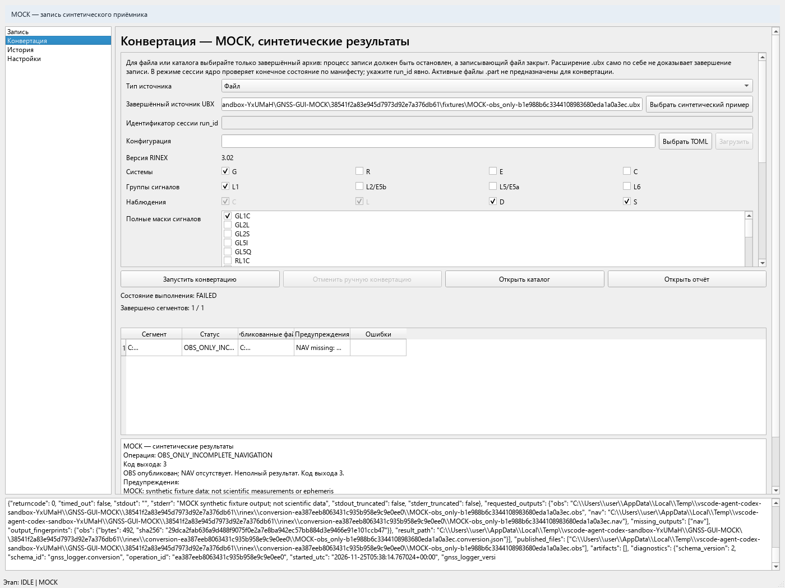

# Stage 4.4 — конвертация RINEX в GUI

Дата: 2026-11-25. Все проверки offline, без открытия физических COM-портов.
Не выполнялись commit/push, установка зависимостей, изменение основной `.venv`,
аппаратной конфигурации, научной обработки и переход к Stage 4.5.

## 1. Исходное состояние

- GNSS Logger 0.5.0.dev2, `main`, HEAD `e71f91e9e46e7d459b23160727d39ca6a870a978`.
- Windows 10 x64, Python 3.15.1, PySide6-Essentials/shiboken6 6.12.0.
- Постоянная GUI-среда: `C:/Users/user/AppData/Local/GNSS/.venv-gui`.
- Baseline [Stage 4.3](stage4_3_report.md): 353 total, 350 PASS, 2 известных FAIL, 1 SKIP.
- В рабочем дереве уже находились принятые, незакоммиченные Stage 4.1–4.3,
  README/pyproject, GUI и тесты. Посторонние изменения
  [ubx.py](../gnss_logger/device/ubx.py), [diagnostics.py](../gnss_logger/diagnostics.py),
  [test_diagnostics.py](../tests/test_diagnostics.py) оставлены без вмешательства.

Прочитаны технический проект/packaging Stage 4.1, отчёт и build Stage 4.2,
Stage 4.3, [Application API](application_api_readiness_report.md) и
[известные дефекты](known-diagnostics-issues.md).

## 2. Предварительная cancellation/cleanup проверка

До интеграции выполнены **20 последовательных изолированных запусков**
`JobProcessIntegrationTests.test_cancel_real_child_cleans_work_and_keeps_committed_segment`.
Сборка и полный suite параллельно не выполнялись. Каждый запуск создаёт новые временные
данные, запускает реальные Python child processes вместо convbin, ждёт ready barrier,
отменяет второй сегмент и проверяет неизменность первого, завершение двух child и отсутствие `.convbin-*`.

| Запуск | Результат / exit | Время unittest, с |
| --- | --- | ---: |
| 1 | PASS / 0 | 1.050 |
| 2 | PASS / 0 | 0.626 |
| 3 | PASS / 0 | 0.754 |
| 4 | PASS / 0 | 1.746 |
| 5 | PASS / 0 | 0.609 |
| 6 | PASS / 0 | 0.613 |
| 7 | PASS / 0 | 0.578 |
| 8 | PASS / 0 | 0.821 |
| 9 | PASS / 0 | 1.153 |
| 10 | PASS / 0 | 0.756 |
| 11 | PASS / 0 | 1.718 |
| 12 | PASS / 0 | 0.668 |
| 13 | PASS / 0 | 0.665 |
| 14 | PASS / 0 | 0.927 |
| 15 | PASS / 0 | 0.597 |
| 16 | PASS / 0 | 0.879 |
| 17 | PASS / 0 | 0.658 |
| 18 | PASS / 0 | 0.923 |
| 19 | PASS / 0 | 0.519 |
| 20 | PASS / 0 | 0.989 |

Команда каждого запуска: `python -m unittest discover -s tests -p test_conversion_cancel_integration.py -v`.
Первоначальная попытка запуска через package dotted-name не загрузила соседний fixture module
`test_stage31_conversion`; это ошибка команды импорта до исполнения теста, не cancellation failure.
Для серии использован штатный discovery с каталогом tests в import path.

**Прежняя нестабильность не воспроизведена; первопричина остаётся неизвестной.**
Assertions исходного теста не менялись. Cleanup не дополнен retry, задержками или принудительным удалением.

## 3. Реализованные функции и изменённые файлы

| Файл | Изменение Stage 4.4 |
| --- | --- |
| [conversion_coordinator.py](../gnss_logger/gui/conversion_coordinator.py) | Независимые manual Job/monitor, загрузка Settings в worker, Cancel, async shutdown |
| [conversions.py](../gnss_logger/gui/conversions.py) | Production facade и изолированный mock runner над настоящим engine |
| [conversion.py](../gnss_logger/gui/pages/conversion.py) | Источник файл/каталог/run_id, TOML, форма Settings, Run/Cancel, таблица и открытие результатов |
| [receiver_coordinator.py](../gnss_logger/gui/receiver_coordinator.py) | Настройка Auto, отдельные On/Off/Cancel, snapshot очереди, read-only чтение последнего отчёта через HistoryService |
| [receivers.py](../gnss_logger/gui/receivers.py) | Передача conversion_settings в handle; DI Auto worker и ограничение mock-записи её workspace |
| [recording.py](../gnss_logger/gui/pages/recording.py) | Auto controls и реальные сведения очереди/результатов без вычисления научного качества |
| [main_window.py](../gnss_logger/gui/main_window.py) | Раздельное управление записью/manual, защита активных собственных каталогов, совместное async close |
| [app.py](../gnss_logger/gui/app.py) | Актуальное описание и smoke внутри выделенного mock workspace |
| [README.md](../README.md) | Описание текущего этапа |
| Этот отчёт и [снимок страницы](images/stage4_4_conversion.png) | Результаты проверки и инструкция |
| [test_stage44_conversion.py](../tests/test_stage44_conversion.py) | Lifecycle, ошибки, статусы, Auto semantics и реальная auto-конвертация с DI |
| [test_stage44_gui.py](../tests/test_stage44_gui.py) | Форма, TOML, источник, прогресс/таблица и закрытие окна |
| [test_stage44_integration.py](../tests/test_stage44_integration.py) | Сохранность публикации, очередь, параллельная запись, Auto failure и повторное чтение отчёта |

Минимальная совместимая DI-доработка существующего ядра:

- [engine.py](../gnss_logger/conversion/engine.py): keyword-only `invoke_call` у probe/convert.
- [service.py](../gnss_logger/conversion/service.py): передача `invoke_call` конкретной операции.
- [job.py](../gnss_logger/conversion/job.py), [worker.py](../gnss_logger/conversion/worker.py): keyword-only `execute_call`.
- [application/recording.py](../gnss_logger/application/recording.py): keyword-only `worker_factory`.

Все hooks по умолчанию `None` и вызывают прежний production путь. Это позволяет одновременно
проверять manual и Auto без глобального monkeypatch, нового конвертера или второй реализации очереди.
Алгоритмы анализа UBX, ротации, публикации, проверки RINEX и профиль сигналов не менялись.
Аргументы CLI, exit codes и схемы отчётов production сохранены.

## 4. API и семантика

Ручная операция: `ConversionRequest` → `ConversionJob(settings=...)` → `OperationMonitor` → `present_result`.
Файл/каталог/run_id разрешает существующий selection; GUI не строит свой список сегментов и fingerprints.
Сессия требует явный run_id и правильные runs_root/daily_root. Ядро проверяет terminal manifest.
Для внешнего архивного файла невозможно по расширению доказать закрытие стороннего writer:
интерфейс предупреждает об этом, ядро проверяет снимок/fingerprint; активные собственные roots и run_id отклоняются.

Профиль загружается `load_conversion_settings` в фоновом worker. Форма создаёт новое frozen
`ConversionSettings` через `dataclasses.replace`; существующая валидация остаётся authority.
RINEX 3.02 фиксирован, C/L обязательны, D/S опциональны; G/R/E/C, groups и masks только из текущего профиля.
OBS/NAV, opt-in OBS без NAV, timeout, interval, executable и корни доступны в форме.
Изменения относятся к следующему job/recording handle. TOML writer отсутствует: исходный TOML не перезаписывается.
При недоступном convbin Run отключён с объяснением; GUI и запись продолжают работать.

Auto настраивается **до Start**, требует daily projection и валидный профиль. Подготовленный
handle может начать с Off и позднее получить On; неподготовленный handle нельзя сделать auto-capable на лету.
`set_auto_conversion(False)` прекращает admission новых сегментов, не отменяя принятые.
`cancel_conversion()` отменяет только текущее auto-задание, не очередь и не запись.
Закрытые сегменты поступают существующему SegmentWorker; GUI не отслеживает рост UBX таймером.
После Stop handle дожидается Auto-очереди; UI остаётся отзывчивым.

Отображаются реальные enabled/active/queued/statuses/deferred/last_error/last_report, если они доступны.
Подробности последнего auto-отчёта читаются в worker через HistoryService и present_result:
файлы, statuses, warnings/errors. Это не полноценная история. После ошибки чтения доступна
явная кнопка повторного чтения; автоматического бесконечного retry нет.

Статусы операции и сегментов не смешиваются: SUCCESS, SUCCESS_WITH_WARNINGS,
ALREADY_CONVERTED, SKIPPED, FAILED, CONFLICT, INCOMPLETE_NAVIGATION,
OBS_ONLY_INCOMPLETE_NAVIGATION, INTERRUPTED, NOT_RUN, DRY_RUN отображаются как есть.
У SKIPPED показана причина, без сообщения о готовом RINEX. OBS_ONLY явно означает
«OBS опубликован; NAV отсутствует; результат неполный; exit code 3». Нового PARTIAL нет.
Предупреждения C6I/E6B/E6X/BeiDou остаются warnings существующего ядра.
Нет выдуманного процента convbin; показано число завершённых сегментов.

## 5. Закрытие и независимость

Один manual job не блокирует запись. Пересечение выбранного архивного источника с каталогами
текущей записи отклоняется; при параллельном Auto показано предупреждение о дублировании работы.
Имена/каталоги результатов по-прежнему изолирует engine.

При закрытии активных операций: «Да» — Stop записи, Cancel manual и ожидание Auto-очереди;
«Нет» — Stop записи, ожидание manual и Auto-очереди; «Отмена» — остаться.
После подтверждения новые операции запрещены. Cancel manual/current auto остаются отдельными
действиями во время ожидания. Уже опубликованные outputs сохраняются.
Workers/metadata readers остаются под владением до фактического завершения; GUI не делает join/wait
и не уничтожает работающий поток. Атомарный commit не прерывается.

## 6. Тестовая среда и результаты

Mock backend использует настоящие service/engine/Job/SegmentWorker, существующий synthetic UBX
и структурные OBS/NAV fixtures с COMMENT «MOCK SYNTHETIC». **RTKLIB convbin в новых GUI-тестах
не запускался**: вместо него передаётся ограниченный callable runner, без создания subprocess.
В отдельной предварительной серии действительно запускались управляемые Python children.
Источники, outputs и mock recording ограничены выделенным каталогом; пользовательские научные
каталоги не используются. Settings и созданный Job/worker сохраняют выбранный mock scenario.

Промежуточные результаты:

- Существующая конвертация Stage 3.1: 39/39 PASS, 22.265 s.
- Stage 4.3 после интеграции: 24/24 PASS, 29.533 s.
- Новые coordinator/Auto тесты: 16/16 PASS.
- Новая форма/TOML/window: 7/7 PASS, 3.745 s в повторном прогоне.
- Первые integration: 3/3 PASS, 23.496 s; после добавления Auto failure — 4/4 PASS, 38.191 s.
- Связанный Stage 4.4 с explicit metadata retry: 28/28 PASS, 44.270 s.
- Smoke прежнего сценария записи через новый GUI: PASS, heartbeat=81, UI-thread delivery=true, exit 0.

Ревью обнаружило P2: после неудачного чтения отчёта Auto путь считался уже просмотренным.
Добавлена явная команда повторного чтения и регрессионный тест; фоновые циклические retry не вводились.
Во время реализации устранена ошибочная кодировка русских подписей; финальные строки проверены чтением UTF-8.

Полный прогон после интеграции: **382 total, 379 PASS, 2 известных FAIL, 1 SKIP,
0 ERROR**, 134.300 s. Затем добавлен отдельный regression отображения всех 11 wire
статусов и tooltips полных значений: итоговый связанный набор **30/30 PASS**, 46.537 s.
Редакторские проверки шести GUI-модулей — без ошибок. `git diff --check` — без ошибок;
предупреждение Git о будущей нормализации LF/CRLF не является whitespace failure.
CLI `--version` и `convert --help` — exit 0, версия/аргументы прежние.

**Окончательный последовательный прогон:**
`python -m unittest discover -s tests -q` — **383 total: 380 PASS, 2 известных FAIL,
1 SKIP, 0 ERROR**, 122.976 s. Относительно baseline добавлено **30 успешных тестов**.
Все новые тесты проходят. FAIL прежние: `test_all_chunk_boundaries_and_mixed_stream`
(`14 != 0`) и `test_sfrbx_length_mismatch_is_not_counted` (префикс ключа `02-13:`).
SKIP прежний: отсутствующий локальный saved UBX. Exit полного набора — 1 именно из-за
двух известных дефектов, а не «полностью зелёный suite». Исходный cancellation integration
также прошёл в полном наборе. Пять core-модулей с DI и новый integration module прошли
редакторскую проверку без ошибок.

Повторный source smoke из родительского каталога GNSS: **PASS**, exit 0,
heartbeat=74, ui_thread_delivery=true. Постоянная GUI-venv и абсолютный launcher
работают вне Git cwd. Это smoke записи/закрытия; новые conversion-сценарии проверены
отдельными 30 тестами.

Снимок настоящей страницы Qt с результатом OBS_ONLY/3:



Снимок сделан offscreen, не на реальном приёмнике. Для preview явно загружены
системные Segoe UI fonts: offscreen backend без этого отображал квадраты вместо
глифов. Исходные строки UTF-8 корректны; screenshot не является проверкой Windows DPI
или production font fallback. Колонки имеют tooltips с полными статусами и путями.

## 7. Запуск и пользовательская mock-проверка

Из любого каталога PowerShell:

```powershell
& 'C:/Users/user/AppData/Local/GNSS/.venv-gui/Scripts/python.exe' 'C:/Users/user/AppData/Local/GNSS/src/gnss-logger/tools/launch_gui_stage4_2.py' --mock
```

Имя launcher сохранено, но он загружает текущие исходники Stage 4.4. EXE Stage 4.2 не обновлялся.

1. Откройте «Конвертация». В MOCK автоматически загружен синтетический профиль, executable
   Python используется только как существующий файл для fingerprint — не запускается как convbin.
2. Выберите сценарий success/warnings/obs_only/failed/slow/skipped и кнопку синтетического источника.
3. Для obs_only явно включите разрешение OBS без NAV; без opt-in строгий режим сохранён.
4. Нажмите Run. Проверьте wire status, exit code, таблицу, warnings/errors и опубликованные пути.
5. Для slow нажмите Cancel; дождитесь завершения. Ранее опубликованные сегменты остаются видны.
6. На «Запись» обновите synthetic inventory, определите MOCK-приёмник, включите daily projection,
   «Подготовить Auto» и Auto On. Используется текущая форма профиля страницы «Конвертация».
7. Нажмите Start. Проверяйте запись параллельно ручной конвертации отдельного mock-архива.
   Off запрещает новые задания, Cancel current auto не останавливает запись. В короткой сессии
   сегмент может закрыться только при Stop: до этого очередь пуста, и это нормальное состояние.
8. Нажмите Stop либо закройте окно с подтверждением; дождитесь manifest и Auto-очереди.
   Проверьте последний отчёт Auto, его файлы/предупреждения отдельно от статуса записи.

TOML можно загружать и менять в памяти. В MOCK его пути результатов должны находиться внутри
показанного mock workspace; профиль с production roots будет отклонён для защиты пользовательских данных.
Никакого Save/перезаписи TOML нет.

## 8. Ограничения и готовность

- Только offline acceptance на текущем Windows/Python; не аппаратный и не научный PASS.
- Не проверены реальный convbin через GUI, USB disconnect, чистые Win10/11, DPI/accessibility и новая frozen поставка.
- Отмена cooperative: чтение/хеширование/атомарная публикация не дают обещания мгновенного выхода.
  Нет Cancel диагностики и общей очистки всей Auto-очереди; уже принятая очередь дренируется.
- Live API даёт последний Auto report и счётчики, а не бесконечную историю всех законченных заданий.
  Подробная история, сохранение TOML/preferences и installer остаются Stage 4.5+.
- Реальный executable выбирается существующей конфигурацией; новая версия RTKLIB и профиль RINEX не вводились.
- После изменения формы `report.settings` содержит фактически применённый профиль;
  `config_path` — историческая ссылка на TOML, а не обещание сохранения этих изменений в файл.
- Два старых дефекта диагностики остаются OPEN, независимо от GUI/конвертации.

Программная основа для Stage 4.5 подготовлена: операции имеют независимое управление,
структурированные результаты и безопасное закрытие. Следующий этап можно планировать
после принятия этой реализации; это не отменяет отдельных аппаратных/packaging acceptance gates.
Stage 4.5 автоматически не начинается. Коммит и push требуют отдельного запроса.
